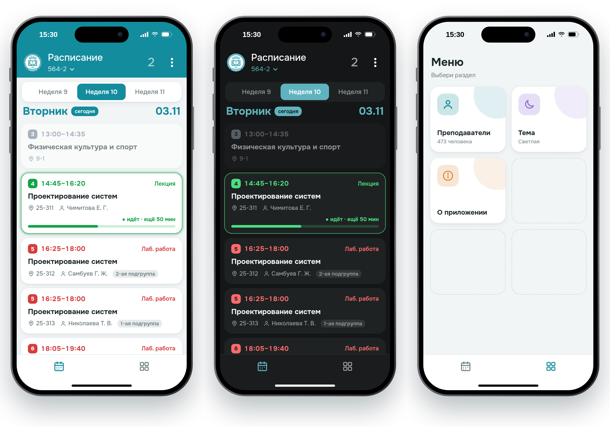

<h1> Расписание ВСГУТУ</h1>

Неофициальное расписание пар ВСГУТУ для телефона. Приложение не связано с университетом. Если что-то не сходится, сверяйтесь с сайтом вуза.

## Что умеет

- 📅 Расписание группы по неделям, текущая пара с таймером
- 👤 Расписание преподавателей, поиск по фамилии
- 👥 Фильтр по подгруппам
- ⭐ Избранные группы и преподаватели
- 🌗 Светлая и тёмная тема
- 📲 Можно добавить на главный экран как приложение

## Откуда данные

Расписание автоматически берётся с сайта вуза и обновляется само.
